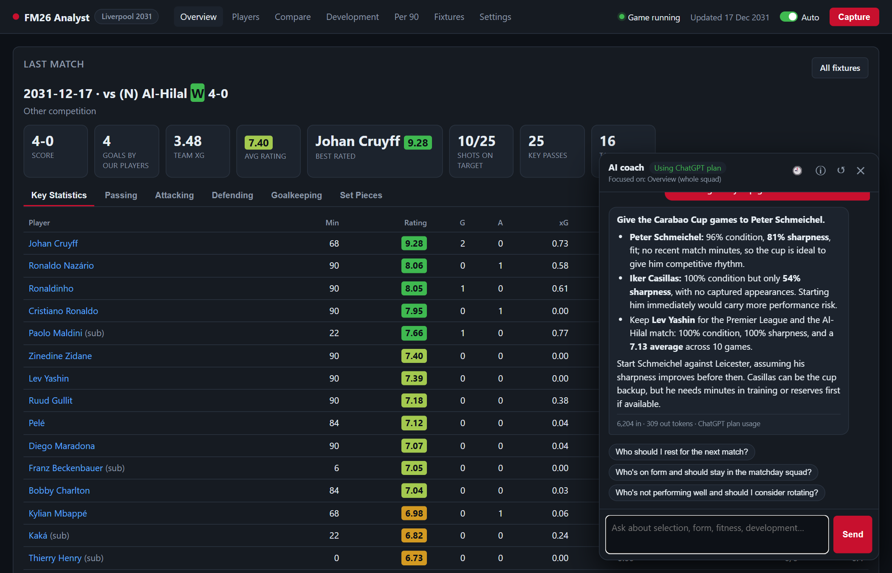
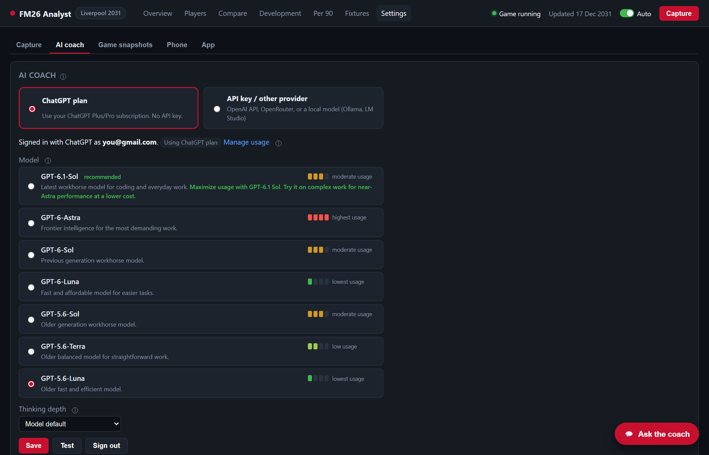

# AI coach

[← Using the dashboard](dashboard.md) · [Guide index](../../README.md#guide) · Next: [Phone app →](phone.md)

The AI coach is an assistant manager you can chat with. It answers from your captured stats and focuses on the page you're viewing.



- [Asking the coach](#asking-the-coach)
- [Choosing a provider](#choosing-a-provider)
  - [ChatGPT plan](#chatgpt-plan-no-api-key)
  - [OpenAI API](#openai-api)
  - [OpenRouter](#openrouter)
  - [Ollama (free, runs on your PC)](#ollama-free-runs-on-your-pc)
  - [LM Studio (free, runs on your PC)](#lm-studio-free-runs-on-your-pc)
  - [Other OpenAI-compatible providers](#other-openai-compatible-providers)
- [Coach instructions](#coach-instructions)
- [What's sent, and privacy](#whats-sent-and-privacy)
- [Coach problems](#coach-problems)

## Asking the coach
Click **Ask the coach** (bottom right, on every page) and type a question, or pick a suggested one. For example:
- *Who should I rest for the next match?*
- *Who's on form and should stay in the matchday squad?*
- *Who isn't performing and should I consider rotating?*
- *Which young players need development minutes, and in which games?*
- *Should I give my cup games to the backup keeper?*
- On a player page: *How has he developed, and what should his training focus be?*

How it works:
- **Page focus:** the coach always sees a summary of the whole squad, plus detail for the page you're on: the player, the match, the comparison or the development period. The panel header shows what it's focused on.
- **Look-ups:** when it needs more, it fetches a player's full detail or a match's stats by itself. You'll see *"🔎 Looking up …"* while it does, and the look-ups are listed under the answer.
- **Usage** is shown under each answer: tokens in and out, the cost where the provider reports it (OpenRouter does), or that the answer counts against your ChatGPT plan.
- **Saved conversations:** **🕘** lists earlier conversations to reopen or delete, and **↺** starts a new one. They're saved per [game snapshot](game-snapshots.md) and survive restarts.
- **ⓘ** shows exactly what data was sent to the model.

## Choosing a provider
Open **Settings › AI coach** and choose either **ChatGPT plan** or **API key / other provider**.



| Provider | Cost | Setup | Quality |
|---|---|---|---|
| **ChatGPT plan** | Included in ChatGPT Plus/Pro (counts against your usage limits) | Sign in, no key | Excellent |
| **OpenAI API** | Pay per use (`gpt-4o-mini` costs a fraction of a penny per answer) | API key | Excellent |
| **OpenRouter** | Pay per use, many models, cost shown per answer | API key | Depends on the model |
| **Ollama / LM Studio** | Free, runs on your PC, works offline | Install and download a model | Depends on the model and your hardware |

> **Tested:** the **ChatGPT plan** has been used live with FM26 Analyst. The others (OpenAI API, OpenRouter, Ollama, LM Studio) use the standard OpenAI-compatible API that the app's automated tests cover, but haven't been tried live yet. Treat their steps below as suggestions, and please [report any problems](https://github.com/lastrider04/FM26-Analyst/issues).

### ChatGPT plan (no API key)
1. In **Settings › AI coach**, choose **ChatGPT plan**.
2. Click **Continue with ChatGPT**. Your browser opens chatgpt.com. Sign in with the account that has your subscription, and allow plan usage.
3. Back in the app, it shows **Signed in as …** with a **Using ChatGPT plan** badge.
4. **Choose a model.** Each model has a **usage meter** from *lowest* to *highest* usage, estimated from OpenAI's own model descriptions. OpenAI doesn't publish exact rates.
5. **Thinking depth:** *Low* is plenty for squad questions. Deeper thinking uses more of your plan on any model.
6. Click **Save**, then **Test**.

This uses OpenAI's *Sign in with ChatGPT for locally hosted apps* (in preview):
- **What the app can and can't do:** it can use your plan for coach answers. It can't see your ChatGPT conversations.
- **Usage limits:** review or cap your usage in ChatGPT under **Settings › Usage** (the **Manage usage** link).
- **Sign out** disconnects the app and revokes its access.

> **"Workspace" or "plan usage not granted" errors:** sign in with the account that actually has the subscription. If you first signed in with a different account, click **Sign out** and sign in again.

### OpenAI API
1. Create an API key at [platform.openai.com/api-keys](https://platform.openai.com/api-keys), and add a payment method under *Billing*.
2. In **Settings › AI coach**, choose **API key / other provider**, then click the **OpenAI** preset.
3. Paste the key into **API key**. The model is `gpt-4o-mini` by default; any chat model your key can use works.
4. Click **Save**, then **Test connection**.

### OpenRouter
1. Create a key at [openrouter.ai/keys](https://openrouter.ai/keys) and add credit.
2. Choose **API key / other provider**, then click the **OpenRouter** preset.
3. Paste the key. For the model, use any ID from [openrouter.ai/models](https://openrouter.ai/models), for example `openai/gpt-4o-mini`.
4. Click **Save**, then **Test connection**. Each answer then shows its cost.

### Ollama (free, runs on your PC)
1. Install [Ollama](https://ollama.com/download).
2. Download a model. In a terminal, run:
   ```
   ollama pull llama3.1
   ```
3. Choose **API key / other provider**, then click the **Ollama (local)** preset. The base URL is `http://localhost:11434/v1`, with no key needed.
4. Click **Save**, then **Test connection**.

Local models are free and private, but smaller ones give weaker answers and some can't do look-ups. The coach still works without look-ups. Running a model while FM26 is running needs a decent GPU.

### LM Studio (free, runs on your PC)
1. Install [LM Studio](https://lmstudio.ai), download a model, load it, and start the **local server** (Developer tab).
2. Choose **API key / other provider**, then click the **LM Studio (local)** preset. The base URL is `http://localhost:1234/v1`.
3. Click **Test connection**. It lists the loaded models; choose one in **Model**, then **Save**.

### Other OpenAI-compatible providers
Any service with an OpenAI-compatible `/v1/chat/completions` endpoint works: enter its **base URL**, a **model** name and your **API key**.
- **Optional features:** if the endpoint doesn't support streaming usage, look-ups or temperature, the app notices and carries on without them.
- **Creativity (temperature 0–1):** lower is more factual and consistent. 0.4 is the default.

## Coach instructions
**Settings › AI coach › Coach instructions** shows the system instructions sent with every question. They set:
- **The role:** an assistant manager;
- **The FM rules it applies:** condition, jadedness, sharpness and ratings;
- **How it answers:** it uses numbers from your data and never invents players or stats.

Edit them to change the coach's style or focus, for example *"Always answer in bullet points"* or *"Prefer playing youth players"*. Click **Save instructions**; **Reset to default** restores the built-in version. Your edited version is saved as `data\coach_prompt.md`.

## What's sent, and privacy
- **What gets sent:** with each question, the app sends the model a compact summary of your squad (names, positions, condition, form, stats, fixtures and the app's own recommendation), plus detail for the page you're viewing, and any look-ups it makes. Click **ⓘ** in the chat to see exactly what was sent.
- **Where it goes:** only to the provider you chose. With Ollama or LM Studio, nothing leaves your PC.
- **How keys are stored:** API keys and ChatGPT sign-in tokens are encrypted with Windows DPAPI, so only your Windows account can decrypt them. They're never shown again or written to the log, and an API key is only sent to the base URL you set.

## Coach problems

| Problem | What to do |
|---|---|
| *"The AI coach isn't set up yet"* | Add an API key and **Save**, sign in with ChatGPT, or choose a local model. |
| *404* | Check the base URL and the model name. |
| *401 / invalid key* | Check the key on the provider's site, then paste it again. A key with spaces or line breaks fails. |
| *429 / rate limit / quota* | You've hit the provider's limit, or run out of credit. Wait, add credit, or choose a cheaper model. |
| ChatGPT: model list is empty | Click **Sign out**, sign in again, and allow plan usage. |
| ChatGPT: *503* | OpenAI's service was busy. The app retries by itself; try again shortly. |
| Answers arrive all at once on the phone | Your proxy is buffering. See [Reverse proxy](phone-reverse-proxy.md#streaming-coach-answers). |
| The coach gets a player wrong | Capture again so the data is current. Check **ⓘ** to see what it was given. |

---
[← Using the dashboard](dashboard.md) · [Guide index](../../README.md#guide) · Next: [Phone app →](phone.md)
