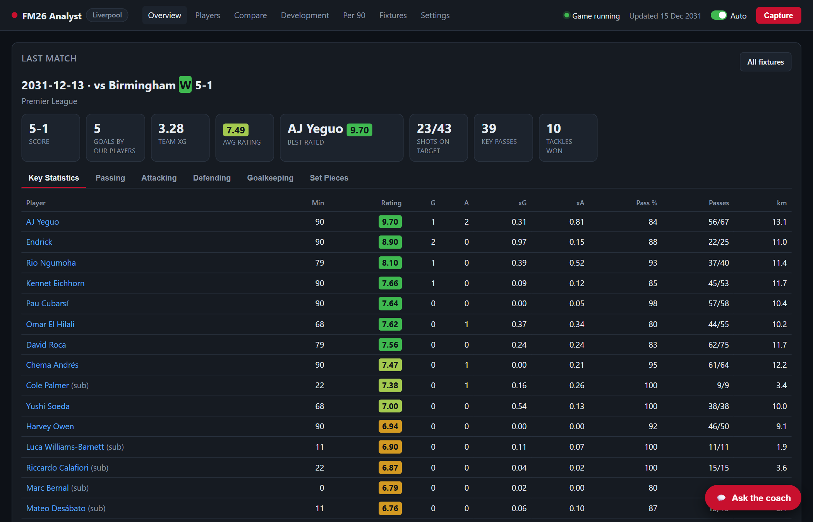
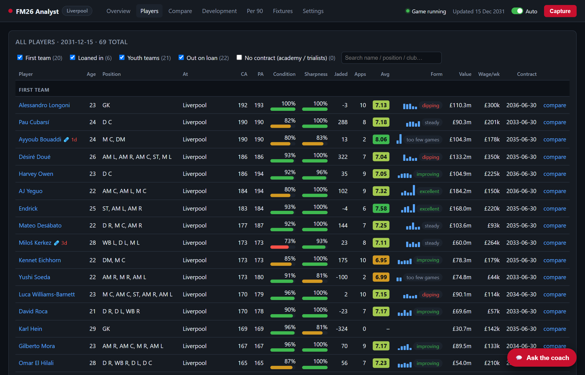
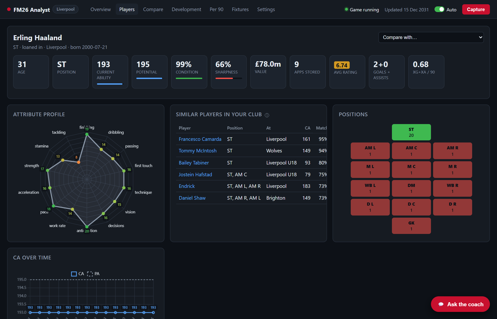
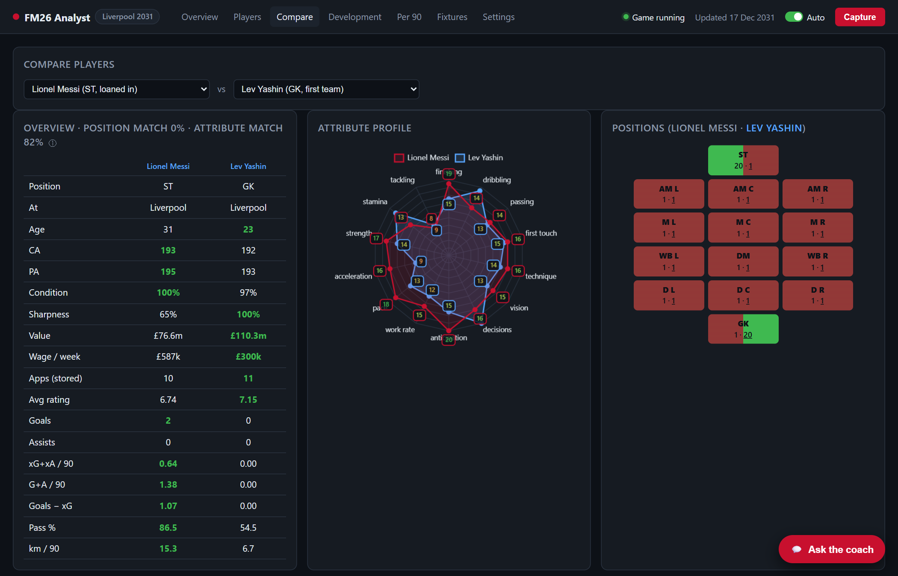
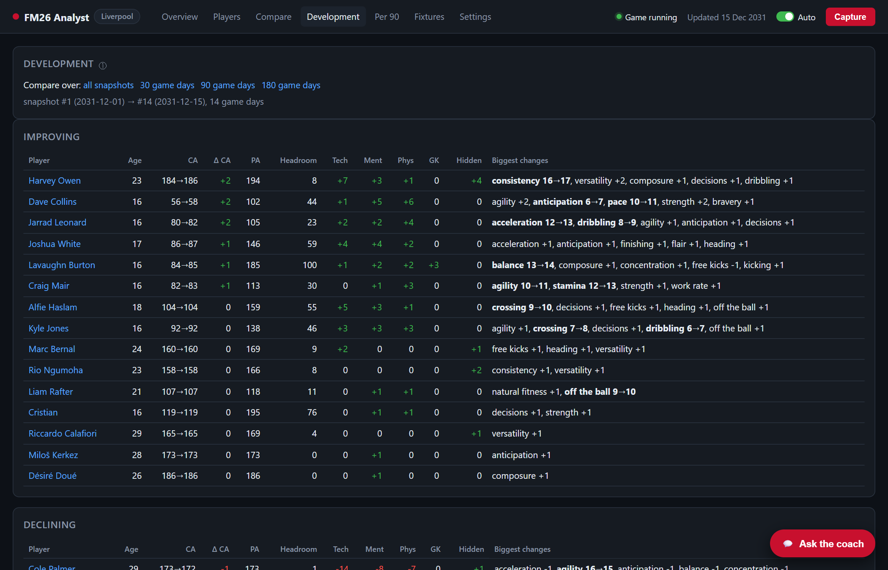
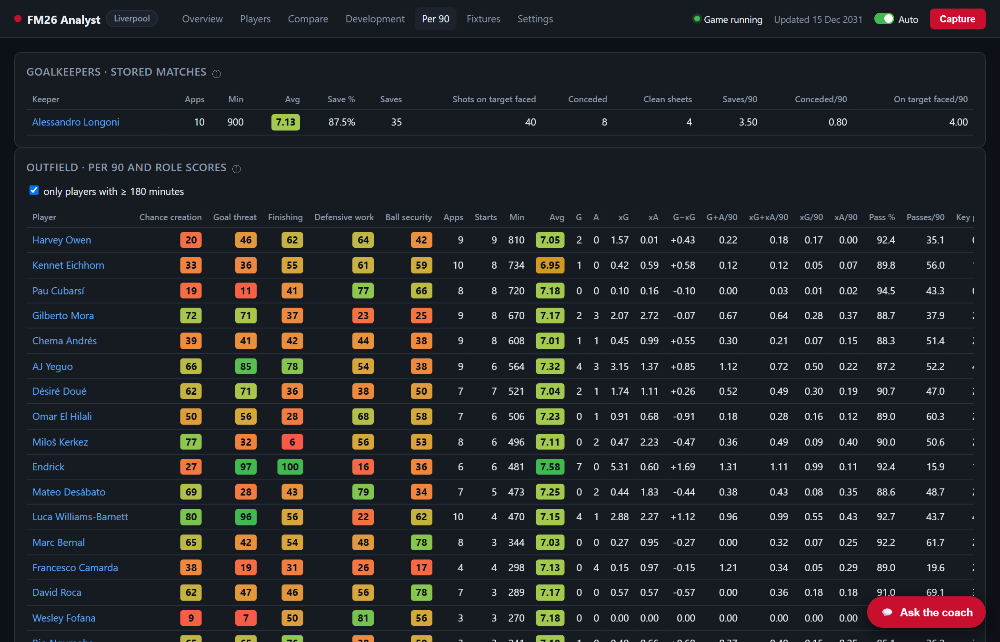
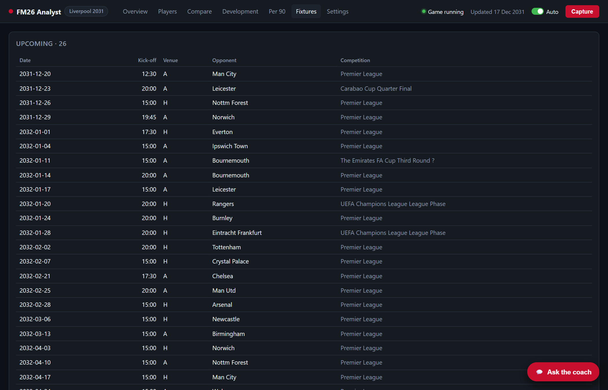
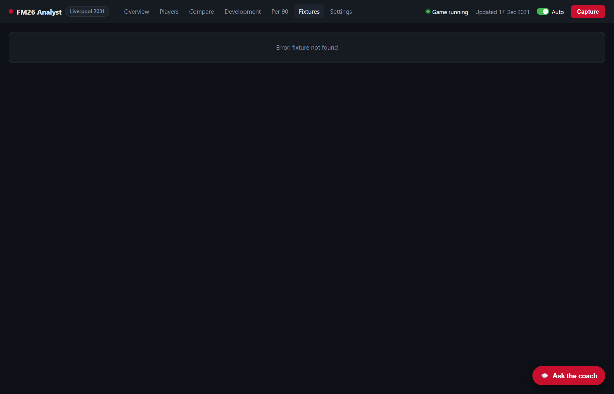

# Using the dashboard

[← Getting started](getting-started.md) · [Guide index](../../README.md#guide) · Next: [AI coach →](ai-coach.md)

Every page reads from your captured history, so it works even when FM26 isn't running. The **ⓘ** icons next to titles explain each card, and short column headers explain themselves when you hover over them.

- [Overview](#overview)
- [Players](#players)
- [Player page](#player-page)
- [Compare](#compare)
- [Development](#development)
- [Per 90](#per-90)
- [Fixtures and match reports](#fixtures-and-match-reports)
- [Ratings colours](#ratings-colours)

## Overview

The page you'll use most:

- **Last match:**
  - the score and KPI tiles (goals, team xG, average rating, best-rated player, shots on target, key passes, tackles won);
  - every player's stats, in tabs: *Key statistics, Passing, Attacking, Defending, Goalkeeping, Set pieces*.

  Click a player's name to open their page.
- **Team form:** your recent results. Click one for its match report. Upcoming fixtures are underneath.
- **Alerts:**
  - injured players, with the expected return date;
  - low condition, high jadedness and low match sharpness.
- **In form:** the best performers over the last 5 captured matches, from ratings and goal involvements. A player needs at least 2 appearances in those matches.
- **Recommended for the next match:** the app's own suggestions, from your captured data:
  - **Picks:** the best-placed starters, using form (with recent trend), goal threat (xG + xA per 90), ability (CA) and fitness.
  - **Swaps:** for anyone who should sit out, a like-for-like replacement, preferring players natural in that position.
  - **Rest:** players to rest. A player is **unfit** if injured, below 85% condition or above 300 jadedness. **Caution** flags show for 85–90% condition, 200–300 jadedness, sharpness under 70%, or 170+ minutes in the last two matches.

  Injured players are never picked. The **ⓘ** shows which capture the condition figures come from.

## Players

Everyone at the club, grouped as **First team, Loaned in, Youth teams, Loaned out**. Use the chips at the top to choose which groups show; your choice is remembered.

For each player you get:
- age, position and where they're playing;
- CA/PA;
- condition, sharpness and jadedness;
- appearances, average rating and a form sparkline;
- value, wage and contract end.

Injured players have a 🩹 badge. Click a column header to sort, and click a row to open the player.

## Player page

- **Header:** position(s), age, CA/PA, value, contract and injury status.
- **Attributes:** a colour-coded radar, plus every attribute grouped Technical / Mental / Physical (or Goalkeeping).
- **CA history:** how their ability has changed across your captures.
- **Match log:** each captured match with minutes, rating and key stats.
- **Role profile:** their [role scores](#per-90) compared with the rest of the squad.
- **Similar players:** squad-mates with the closest attribute profile and position. Click one to compare them.
- **Goalkeepers only:** save %, clean sheets and goals conceded per 90.

## Compare

Two players side by side: attributes, CA/PA and their stats. Choose the two players at the top, or click **Compare with…** on a player page.

## Development

Who's improving and who's declining:
- **The period:** compare **all snapshots**, or the last **30, 90 or 180 game days**. The line under the choices shows which two captures are compared.
- **Improving** and **Declining** tables. For each player:
  - CA before → after and the change (Δ CA);
  - PA and **headroom** (PA − CA, their room to grow);
  - the total change in each attribute group: Technical, Mental, Physical, Goalkeeping and Hidden;
  - **Biggest changes:** the attributes that moved most. Bold means the change shows in the game's 1–20 value; otherwise it's a smaller change underneath.

Development needs at least two captures some game time apart.

## Per 90

Stats per 90 minutes, for players with **180+ minutes** in captured matches:

- **Goalkeepers:**
  - **Save %:** saves ÷ shots on target faced;
  - goals conceded per 90;
  - **Clean sheets:** matches of 60+ minutes without conceding.
- **Outfield role scores:** each player ranked against the rest of your squad (as a percentile) for:
  - **Chance creation:** xA, key passes and chances created;
  - **Goal threat:** xG and shots;
  - **Finishing:** goals compared with xG, and shot accuracy;
  - **Defensive work:** tackles, interceptions and pressures;
  - **Ball security:** possession kept against possession lost.

Hover over any column header for exactly what it counts.

## Fixtures and match reports

- **Results:** all your captured results, with competition and score.
- **Upcoming fixtures:** with kick-off times.

Click a result to open its match report.

The **match report** shows the full player stats for that match in the same tabs as the Overview. Use **← Previous** and **Next →** to step through matches.

## Ratings colours
Match ratings are coloured from orange (poor) through amber and light green to green (excellent). The attribute radar on player pages is coloured the same way.

---
[← Getting started](getting-started.md) · [Guide index](../../README.md#guide) · Next: [AI coach →](ai-coach.md)
