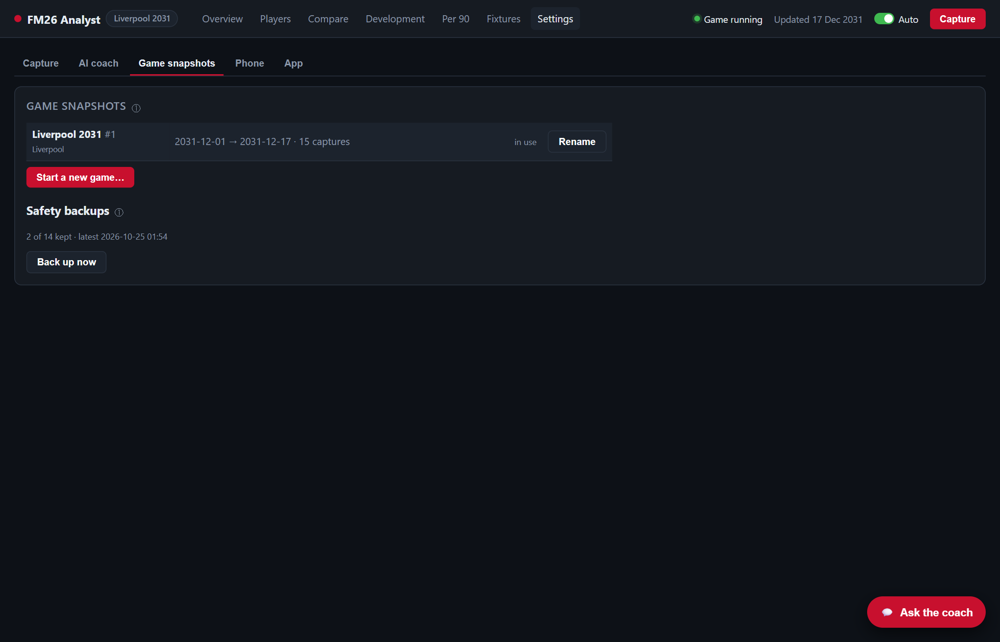

# Game snapshots and backups

[← Phone app](phone.md) · [Guide index](../../README.md#guide) · Next: [Troubleshooting →](troubleshooting.md)

A **game snapshot** is one separate history: one FM save, or one job. Keeping them apart means a new save, or a new club, never mixes with your old career's stats and development.

- [How the app keeps saves apart](#how-the-app-keeps-saves-apart)
- [Starting a new game or job](#starting-a-new-game-or-job)
- [Switching, renaming and deleting](#switching-renaming-and-deleting)
- [Loading an older save file](#loading-an-older-save-file)
- [Backups](#backups)
- [Restoring a backup](#restoring-a-backup)
- [Moving to a new PC](#moving-to-a-new-pc)

## How the app keeps saves apart
**Different saves are detected automatically.** At each capture, the app compares the players at your club with each snapshot's history:
- **Fewer than about a third of the players match** any snapshot: it's a different save. The app creates a new snapshot by itself and tells you in the top bar.
- **Otherwise:** the capture goes into the matching snapshot. Loading the same career on another day, or a backup copy of the same save, stays in the same snapshot.

The snapshot in use is shown next to **FM26 Analyst** in the top bar. Every page, the coach and its saved conversations follow the snapshot in use.

## Starting a new game or job
When you start a new save, or take a job at another club in the same save:

1. Open **Settings › Game snapshots** and click **Start a new game…**
2. **Name it** (e.g. *Real Madrid job*) and **search for the club** you're managing. FM26 must be running for the full club list.
3. Read the warning, tick **I understand**, and click **Start new game snapshot**.

Your current snapshot is **backed up first and kept unchanged**; you can switch back at any time. The dashboard switches to the new, empty history, and captures go there from now on. In FM, load the new save (or be at the new club) before the next capture.

> **Why do this by hand for a new job?** In the same save, your old club's players are still in the game. A manual new snapshot makes the split clean, and sets the app to follow your new club.

## Switching, renaming and deleting
In **Settings › Game snapshots**:
- **Switch to:** makes that snapshot the one in use. The dashboard and the club the app follows switch with it.
- **Rename:** gives it a clearer name.
- **Delete:** permanently deletes an inactive snapshot's history. You'll be asked to confirm. You can't delete the one in use.

## Loading an older save file
If you reload an earlier save of the same career (e.g. to replay a match), the game date goes backwards. The app notices, notes *"older save file loaded: date → date"* on that snapshot, and carries on in the same snapshot. Captures from the abandoned timeline stay in the history.

## Backups
- **When:** the database of the snapshot in use is backed up **once a day** (at start-up and after captures), and **before every new game** you start.
- **How many:** the newest **14** are kept per snapshot.
- **Back up now** makes one at any time.
- **Where:** `data\backups\save-<n>\`. The **ⓘ** next to *Safety backups* shows the exact folder.

## Restoring a backup
1. Quit the app: **Settings › App › Quit FM26 Analyst**.
2. Open `data\backups\save-<n>\` and pick the backup you want. The file names include the date.
3. Copy it over the snapshot's database, renaming it to match:
   - snapshot #1: `data\fm_analyst.db`;
   - later snapshots: `data\careers\<n>\fm_analyst.db`.

   *(Optional)* Keep a copy of the current database first.
4. Start the app again.

## Moving to a new PC
1. Install FM26 Analyst on the new PC ([Installation](installation.md)).
2. Quit the app on both PCs.
3. Copy the whole `data\` folder from the old app folder to the new one.

Your history, snapshots and settings come across. Encrypted secrets don't, because Windows encryption is tied to your Windows account on that PC. On the new PC, re-enter:
- your **API key** or **ChatGPT sign-in**;
- your **Google client secret**;
- the pairing of your **phone**.

---
[← Phone app](phone.md) · [Guide index](../../README.md#guide) · Next: [Troubleshooting →](troubleshooting.md)
