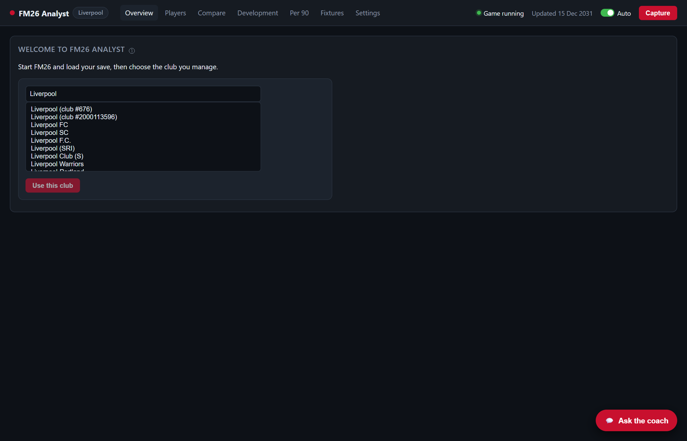
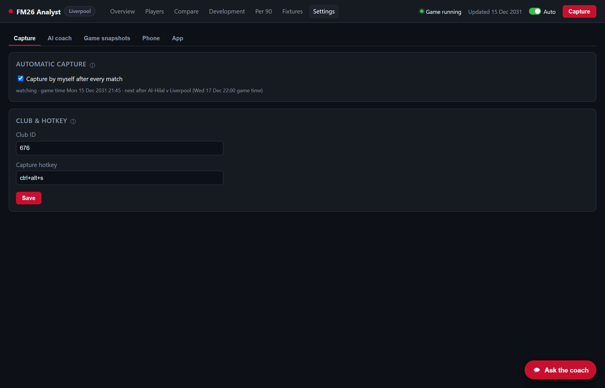

# Getting started

[← Installation](installation.md) · [Guide index](../../README.md#guide) · Next: [Using the dashboard →](dashboard.md)

- [Start the app](#start-the-app)
- [Choose your club](#choose-your-club)
- [Your first capture](#your-first-capture)
- [How capturing works](#how-capturing-works)
- [The top bar](#the-top-bar)
- [Running in the background](#running-in-the-background)
- [Settings › Capture](#settings--capture)

## Start the app
1. **Start Football Manager 26 and load your save.** The app can start before or after the game. If the game isn't running yet, the app waits and connects when it is.
2. **Open FM26 Analyst** from the Desktop or Start menu.

The dashboard opens in its own window. It's a local web page at `http://127.0.0.1:8765` that only your PC can reach. You can also open that address in any browser on the same PC.

## Choose your club
The first time you start the app, the Overview asks which club you manage:

1. Type part of your club's name. The list comes straight from the running game, so FM26 must be running with your save loaded.
2. Select your club. Some names exist more than once in the game's database (there are several "Liverpool"s, for example). Those show their **club ID** so you can tell them apart. Your club in your save is usually the lowest ID.
3. Click **Use this club**.

You can change the club later under **Settings › Capture › Club ID**. If you take a new job or start a new save, use **game snapshots** instead, so each career keeps its own history; see [Game snapshots](game-snapshots.md).

## Your first capture
Click **Capture** in the top right (or press **Ctrl+Alt+S** while you're in the game). A capture takes a few seconds and reads:

- **Every player at your club** (first team, youth teams, loanees): attributes, CA/PA, positions, condition, sharpness, jadedness, injuries, contract and value.
- **Your fixtures and results**, with kick-off times.
- **Per-match player stats** for the matches you've played: ratings, minutes, goals, assists, xG, xA, passes, tackles, saves and around 80 other stats.

The dashboard fills in straight away. Development charts and form get more useful as captures build up over the season.

> **What the app reads, and what it doesn't:** the app only *reads* the game's memory, the same way an external scouting tool does. It never changes the game, your save or any FM26 files. Use it with single-player saves only.

## How capturing works
You don't need to remember to capture:

- **After every match:** while the app runs, it watches the in-game clock. About 2½ game hours after each of your matches kicks off (once it's finished), it captures by itself.
- **Weekly:** if there's no match, it captures once a week of game time.
- **Any time:** use the **Capture** button or the hotkey.

Each capture is a **snapshot** of that moment. Comparing snapshots is how the app shows development (CA and attribute changes) and per-match stats.

The **Auto** switch in the top bar turns automatic capture on or off. Hover over it to see what it's waiting for.

**Reader self-check:** each time FM26 starts, the app runs a quick self-check (it takes a few seconds) to confirm it can read this game build correctly. If the game has been patched and the reader no longer matches, captures pause and a banner explains why, so wrong data is never stored. See [Troubleshooting](troubleshooting.md#fm26-has-been-updated-banner).

## The top bar
From left to right:

| Element | Meaning |
|---|---|
| **FM26 Analyst · *snapshot name*** | The [game snapshot](game-snapshots.md) in use. Click it to manage snapshots. |
| **Page tabs** | Overview, Players, Compare, Development, Per 90, Fixtures, Settings. |
| **● Game running** | Green when FM26 is running and can be read. |
| **Updated *date*** | The game date of the last capture. |
| **Auto** | Automatic capture on or off. |
| **Capture** | Capture now. It's greyed out when the game isn't running. |

Hover over any of them for more detail. Throughout the app, the **ⓘ** icons next to titles and fields explain what you're looking at. Short column headers (xG, KP, Sh%…) explain themselves when you hover over them.

## Running in the background
- **Closing the window doesn't stop the app.** It keeps running in the background, so auto-capture and the hotkey keep working while you play.
- **To bring the window back,** open the shortcut again. It reuses the running app.
- **To stop it completely,** use **Settings › App › Quit FM26 Analyst**.
- **After a PC restart,** open the shortcut again. Auto-capture starts with the app.
- **Logs** are in `data\app.log`.

## Settings › Capture

- **Capture by myself after every match:** the same as the Auto switch. The line underneath shows what it's waiting for, and the last automatic capture.
- **Club ID:** the club the app reads. It normally follows the game snapshot in use, so you rarely need to change it here.
- **Capture hotkey:** for example `ctrl+alt+s` or `ctrl+shift+f9`. It applies after restarting the app. If the hotkey doesn't work, another program may be using it.

---
[← Installation](installation.md) · [Guide index](../../README.md#guide) · Next: [Using the dashboard →](dashboard.md)
