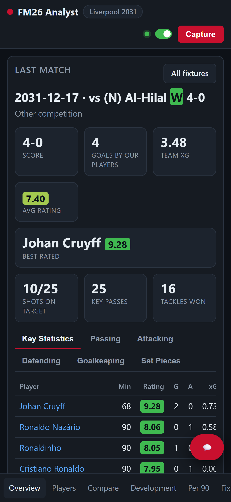
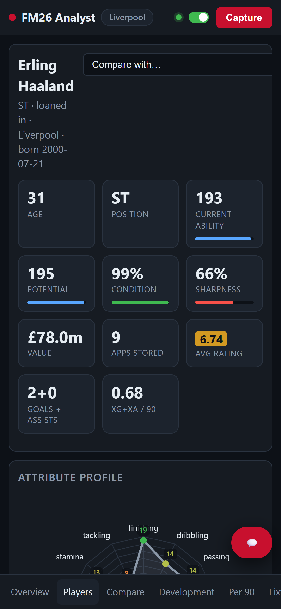
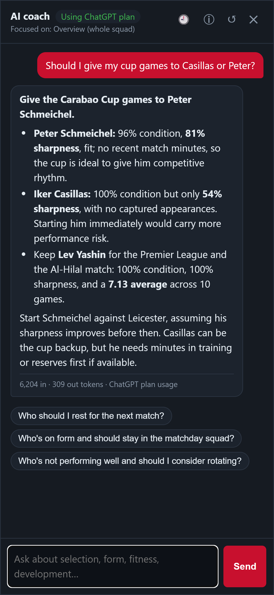
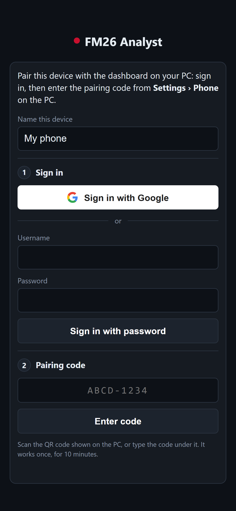
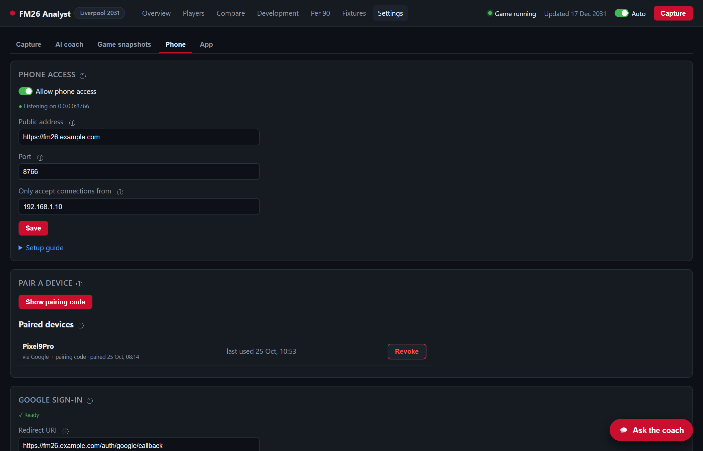

# Phone app

[← AI coach](ai-coach.md) · [Guide index](../../README.md#guide)

FM26 Analyst also runs on your phone. It shows the same dashboard in a mobile layout, with the page tabs at the bottom, and the coach opens full screen. Over HTTPS it installs to your home screen like an app and keeps the last data it loaded, so you can still look things up while your PC is off.

<p>




</p>

- [How it works](#how-it-works)
- [Choose how your phone connects](#choose-how-your-phone-connects)
- [Setup checklist](#setup-checklist)
- [Settings › Phone](#settings--phone)
- [Installing it on your phone](#installing-it-on-your-phone)
- [What the phone can and can't do](#what-the-phone-can-and-cant-do)
- [Phone problems](#phone-problems)

**Detailed pages:**
- **Connection methods:** [Local network (IP and port)](phone-local-network.md) · [Tailscale](phone-tailscale.md) · [Reverse proxy (NGINX Proxy Manager, Caddy, nginx)](phone-reverse-proxy.md) · [Cloudflare Tunnel](phone-cloudflare-tunnel.md)
- **Setup:** [Signing in and pairing](phone-sign-in.md) · [Windows Firewall](firewall.md)

## How it works
The desktop dashboard only listens on `127.0.0.1:8765`, so nothing outside your PC can reach it. For your phone, the app runs a **second, separate listener**:

- **It's off until you turn it on** in **Settings › Phone**.
- **Port:** it listens on **port 8766** by default.
- **Paired devices only:** it only lets in devices you've paired. Pairing takes two steps, signing in **and** entering a one-time code from your PC; see [Signing in and pairing](phone-sign-in.md).
- **Limited actions:** even a paired phone can only read the dashboard, use the coach, Capture and switch Auto. Settings and everything else stay on the PC.

```
Phone ──(Wi-Fi, Tailscale, or the internet via HTTPS)──► your PC :8766 (phone listener) ──► FM26 Analyst
                                                          127.0.0.1:8765 (desktop dashboard, PC only)
```

## Choose how your phone connects

| Method | Works from | HTTPS (install as an app, offline copy, Google sign-in) | Needs | Difficulty |
|---|---|---|---|---|
| **[Local network](phone-local-network.md)** ✅ tested | Home Wi-Fi only | ✗ (works in the browser; password sign-in) | Nothing extra | ★☆☆ Easiest |
| **[Tailscale](phone-tailscale.md)** ⚠️ untested | Anywhere, on your own devices | ✓ | Free Tailscale account and app on PC and phone | ★☆☆ Easy |
| **[Reverse proxy](phone-reverse-proxy.md)** ✅ tested (NGINX Proxy Manager) | Anywhere, any browser | ✓ | A domain, a proxy (e.g. NGINX Proxy Manager), router port forwarding | ★★★ Advanced |
| **[Cloudflare Tunnel](phone-cloudflare-tunnel.md)** ⚠️ untested | Anywhere, any browser | ✓ | A domain on Cloudflare (free plan) | ★★☆ Medium |

✅ **tested** with FM26 Analyst · ⚠️ **untested suggestion**: written from how the service normally works, but not tried yet.

**Which one?**
- **Just want it on the sofa?** Use **[Local network](phone-local-network.md)**.
- **Want it everywhere, with the least setup?** **[Tailscale](phone-tailscale.md)** is worth a try (*untested suggestion*). Nothing is exposed to the internet, and you get HTTPS, so it installs as an app.
- **Already run a home server or proxy with your own domain?** Use a **[Reverse proxy](phone-reverse-proxy.md)**.
- **Have a domain but don't want to open router ports?** Try **[Cloudflare Tunnel](phone-cloudflare-tunnel.md)** (*untested suggestion*).

> **Why HTTPS matters:** phones only install a site as an app, and only keep an offline copy, when it's served over HTTPS. Google also only signs in to HTTPS addresses. Over plain `http://` on your Wi-Fi the dashboard still works fully in the browser, and you sign in with a password.

> **Never forward port 8766 directly** from your router to the internet. If you want access from outside your home, use one of the HTTPS methods above.

## Setup checklist
Whichever method you choose:

1. **Turn on phone access:** in **Settings › Phone**, switch on **Allow phone access**. It should say *Listening on 0.0.0.0:8766*.
2. **Connect:** set up your connection method using its page:
   - firewall rule if needed;
   - **Public address**;
   - **Only accept connections from**.
3. **Set up a sign-in method:** a password, Google, or both. See [Signing in and pairing](phone-sign-in.md).
4. **Pair your phone:** on the phone, open the address, sign in, then enter the pairing code from **Show pairing code** on the PC.
5. **Install it:** add it to your home screen (HTTPS methods). See [Installing it on your phone](#installing-it-on-your-phone).

## Settings › Phone


| Setting | What it does |
|---|---|
| **Allow phone access** | Starts or stops the phone listener. The line under it shows whether it's listening, or why not (e.g. the port is in use). |
| **Public address** | The `https://` address your phone uses (Tailscale, proxy or tunnel). It's used for Google sign-in and for the link in the pairing QR code. Leave it blank for [local network](phone-local-network.md) use; the QR code then uses your PC's IP and port. |
| **Port** | The phone listener's port (default 8766). Your proxy, tunnel or firewall rule must use the same one. |
| **Only accept connections from** | The IP address(es) allowed to connect, separated by commas, for example your proxy's IP or `127.0.0.1, ::1` for Tailscale and Cloudflare. Leave it blank to accept any address on your network. |
| **Setup guide** | The essentials with your PC's own IP and port filled in. |
| **Pair a device** | Shows a one-time pairing code and its QR code. See [Signing in and pairing](phone-sign-in.md). |
| **Paired devices** | Every paired device, how it signed in, and when it was last used. **Revoke** signs it out. |
| **Google sign-in** / **Password (backup)** | See [Signing in and pairing](phone-sign-in.md). |

## Installing it on your phone
Over HTTPS (Tailscale, reverse proxy or Cloudflare Tunnel):

- **iPhone (Safari):** open your address, sign in and pair, then tap **Share › Add to Home Screen**.
- **Android (Chrome):** open your address, sign in and pair, then tap **⋮ › Install app**, or *Add to Home screen*.

It opens full screen with its own icon, and keeps the last data it loaded. When your PC can't be reached, an **Offline** badge appears in the top bar and you see the saved copy.

> **iPhone:** an app added to the home screen keeps its own sign-in, separate from Safari. If you paired in Safari first, open the installed app and pair once more in there. Type the pairing code, since a QR scan opens Safari.

Over plain `http://` on your local network, browsers don't install the site as an app or keep an offline copy. You can still add a home-screen shortcut that opens it in the browser.

## What the phone can and can't do

| On the phone ✓ | PC only ✗ |
|---|---|
| Read every page: Overview, Players, Compare, Development, Per 90, Fixtures, match reports | Settings (capture, coach provider, phone access) |
| Ask the coach, and use its saved conversations | Game snapshots: switch, new game, rename, delete |
| Capture now | Backups |
| Turn Auto on or off | Sign-ins: ChatGPT, Google, password |
| Sign out (**Device** tab) | Quit the app |

The phone's **Settings** tab becomes a **Device** page, showing the device's name, how it signed in, and a **Sign out** button.

## Phone problems

| Problem | Likely cause and fix |
|---|---|
| Can't reach the address at all | **Is phone access on and listening?** Check **Settings › Phone**. **Did Windows block it?** Check the [firewall](firewall.md#checking-it-works). **Is the phone on the right network,** or Tailscale connected? |
| *"Not allowed from this address"* | **Only accept connections from** doesn't include the address the connection really comes from. Clear the field to test, then set it to your proxy's IP (or `127.0.0.1, ::1` for Tailscale and Cloudflare). |
| *"Blocked: request didn't come from the FM26 Analyst app"* | Something rewrote the request headers, or you opened an old cached page. Reload the page. If you use a proxy, make sure it passes the `Host` header through. |
| Wrong code, or *"expired or already used"* | Codes work once, for 10 minutes. Make a new one with **Show pairing code**. |
| *"Too many wrong attempts"* | Password and code sign-in pause for 15 minutes after 5 wrong tries. Wait, or use Google sign-in. |
| Coach answers appear all at once | Your proxy is buffering. See [Reverse proxy › Streaming coach answers](phone-reverse-proxy.md#streaming-coach-answers). |
| Works on mobile data but not on home Wi-Fi (proxy setups) | See [Reverse proxy › Home network problems](phone-reverse-proxy.md#home-network-problems). |
| No **Install app** option, or no offline copy | The address isn't HTTPS. Use Tailscale, a reverse proxy or Cloudflare Tunnel. |

More: [Troubleshooting](troubleshooting.md).

---
[← AI coach](ai-coach.md) · [Guide index](../../README.md#guide) · Next: [Game snapshots →](game-snapshots.md)
